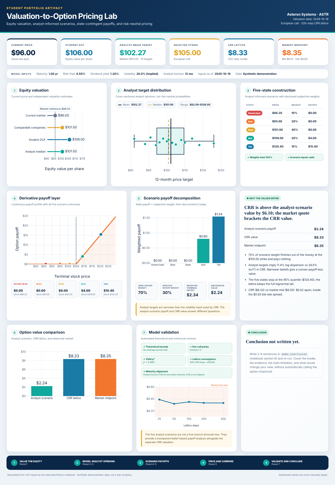

# Valuation-to-Option Pricing Lab

Prices a European call two ways (analyst-belief scenarios and a 200-step CRR lattice), then explains why the results differ.

**[View the live dashboard →](https://YOUR-USERNAME.github.io/YOUR-REPO-NAME/)**



## Headline result

| Method | Value |
|---|---|
| Analyst-scenario discounted payoff | $2.24 |
| CRR risk-neutral lattice | $8.33 |
| Observed market midpoint (bid $8.10 / ask $8.60) | $8.35 |

The CRR value sits inside the market spread. The analyst-scenario value is about $6 lower because:
- 70% of the scenario weight finishes below the $105 strike and pays nothing.
- Analyst targets are much narrower (11.4% log dispersion) than the 28% volatility used by CRR.
- The five states stop at the 95th percentile, so upside beyond $120.40 isn't captured.

The two numbers answer different questions. One gives the expected payoff under analyst beliefs, the other the no-arbitrage replication price. Neither one alone makes the option mispriced.

> Company inputs are **synthetic demonstration data**. "Asteron Systems (ASTR)" is not a real company.

## How it works

```
data/*.csv  ──►  valuation_option_lab.ipynb  ──►  docs/model_results.json  ──►  docs/index.html
 (inputs)          (analysis + validation)          (generated, never typed)      (dashboard)
```

1. **Equity valuation**: spot vs DCF, comparable companies, and the analyst median.
2. **Analyst distribution**: 15 twelve-month targets with summary stats.
3. **Five states**: 5th/25th/50th/75th/95th percentile targets with weights of 10/20/40/20/10%.
4. **Scenario payoff**: probability-weighted call payoff, discounted at the risk-free rate.
5. **CRR lattice**: 200-step binomial tree with a continuous dividend yield.
6. **Validation**: no-arbitrage bounds, put-call parity, p* in (0,1), lattice convergence, maturity alignment.

GitHub Actions re-runs the notebook on every push. If any input or validation check fails, the deploy fails too.

## Run it locally

```bash
pip install -r requirements.txt
jupyter nbconvert --to notebook --execute --inplace valuation_option_lab.ipynb
python -m http.server -d docs 8000   # then open http://localhost:8000
```

## Change the inputs

Edit only the CSVs in `data/`. See [`data/INPUT-GUIDE.md`](data/INPUT-GUIDE.md) for formats, e.g. rates and volatility go in decimal form (`0.045`, `0.28`).

## Repo map

| Path | What it is |
|---|---|
| `data/` | Company inputs, analyst targets, source documentation |
| `valuation_option_lab.ipynb` | Analysis, validation, decision memo |
| `docs/` | Published dashboard and generated JSON |
| `.github/workflows/deploy-pages.yml` | Executes the notebook and deploys to GitHub Pages |
| `instructor/` | Assignment brief, rubric, acceptance checklist |

## Publish

Upload everything to the repository root, including the hidden `.github` folder. Then go to **Settings → Pages** and set the source to **GitHub Actions**.
